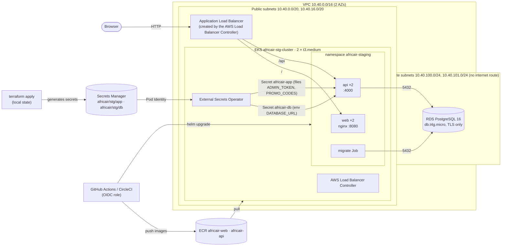

# AfricAir on AWS: architecture (staging)

- Only the ALB receives traffic from the internet. The nodes have public IPs (no NAT gateway), but
  their security group admits nothing from outside the cluster and the ALB.
- RDS lives in subnets with no internet route and accepts 5432 only from the cluster security group.
- AWS permissions inside the cluster come from **EKS Pod Identity**: one role for the Load Balancer
  Controller, one for External Secrets (read-only on the two secrets).
