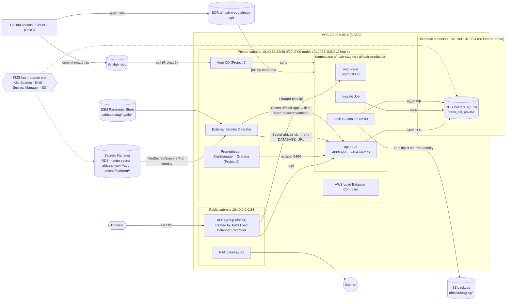

# AfricAir on AWS: architecture (Projects 4 and 5)

- Only the ALB is internet-facing. Nodes reach the internet through the single NAT gateway; RDS can't.
- Every AWS permission inside the cluster comes from **EKS Pod Identity**: ESO, the load balancer
  controller, the EBS CSI driver and the backup job each have their own role, scoped by namespace and
  service account in the trust policy.
- Secret values exist only in Secrets Manager and as Kubernetes Secrets (envelope-encrypted with KMS).
  They are never in Git, Terraform state or CI logs.
